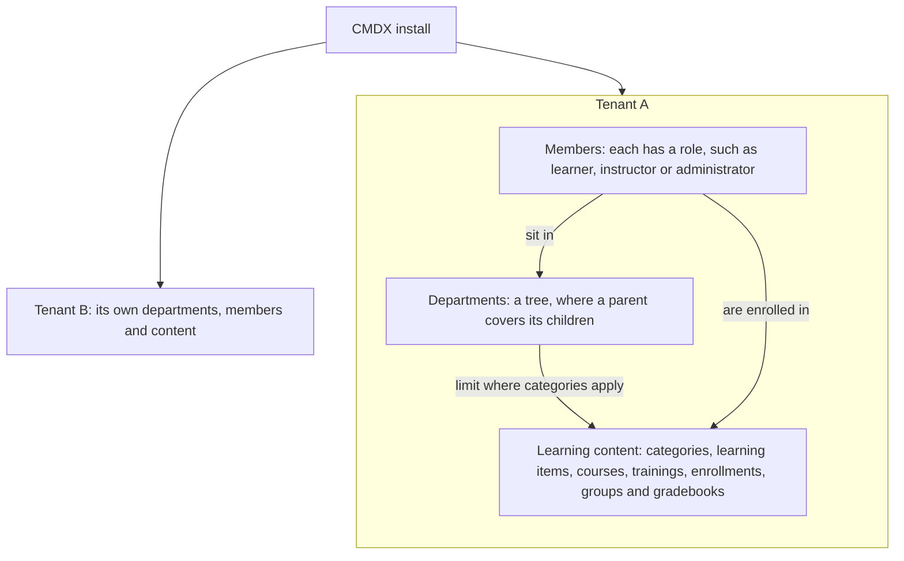
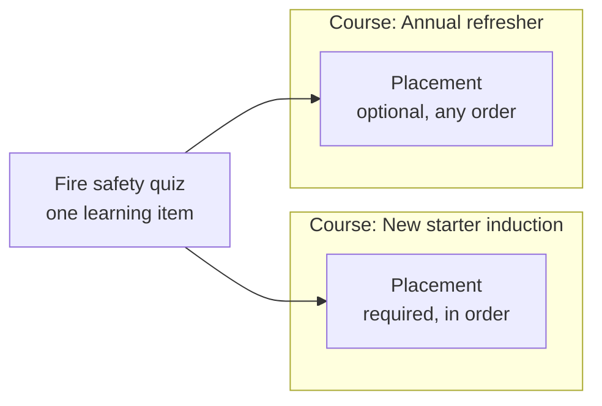
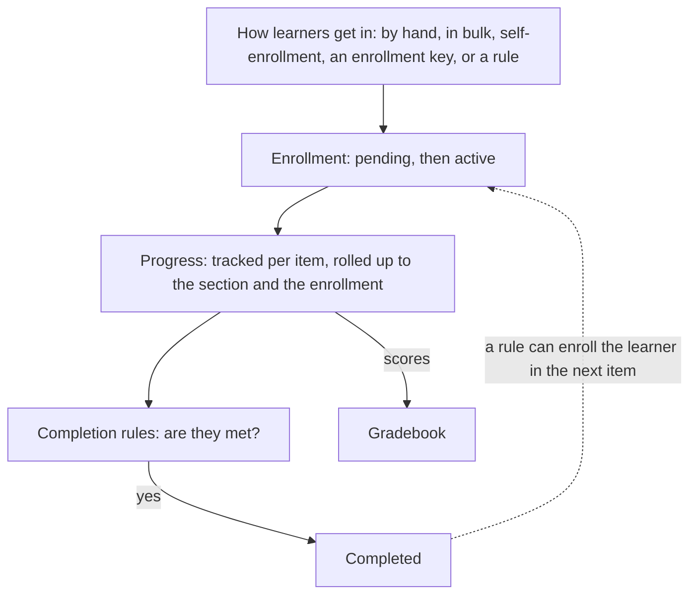

CMDX organizes learning in four layers. Read them in order, from the outermost boundary to one learner finishing one item:

1. **Tenant.** One company, school or team owns its departments, members and all of its content.
2. **Catalog.** Every learning item, of any kind, is one entry in the tenant's catalog, sorted into categories.
3. **Structure.** Courses arrange learning items into sections. One item can appear in many courses without being copied.
4. **Learner's path.** A learner is enrolled, makes progress, meets the completion rules and completes the item.

## 1. The tenant

One CMDX install hosts many tenants. A tenant is the space for one company, school or team. Everything a person does in CMDX happens inside one tenant, and one tenant never sees another tenant's data.

- **Departments** form a tree inside the tenant. A parent department covers the departments beneath it. In learning, departments do one job: they limit where a category applies.
- **Members** are the people in the tenant. Each member has a role, such as learner, instructor, content author or administrator, and can sit in a department. A person can belong to more than one tenant, with a different role in each. Roles can also be given on one course or one category.
- **Learning content** is everything else: categories, learning items, courses, trainings, enrollments, groups and gradebooks. All of it belongs to the tenant.

## 2. The catalog

Every learning item is one entry in the tenant's catalog, whatever its kind:

- courses;
- quizzes and assignments;
- SCORM packages;
- videos and other media;
- files, HTML pages and web links;
- feedback forms;
- instructor-led trainings.

Each item starts as a draft, is published when it's ready, and can later be archived.

**Categories** sort the catalog. A category works like a folder, and categories can contain other categories. A category covers the whole tenant, or only the departments you choose; a sub-category takes its parent's departments unless you narrow them. Each course has one main category and can be added to others. Any other learning item can be in any number of categories.

## 3. Structure

A course arranges learning items into **sections**. A section can contain other sections, up to three levels deep. A section can wait for another section to be finished, or open on a set date.

Learning items aren't copied into courses. Say you build a fire safety quiz. New starters must take it in order as part of their induction. In the annual refresher it's optional. You place the same quiz in both courses, with different settings:

A **placement** puts one learning item into one course or section. The item keeps the content. The placement keeps the settings that belong to that course:

- where the item appears in the course;
- whether learners must complete it;
- whether learners must take it in order, or can take it at any time. If the placement doesn't say, it follows the section, then the course;
- how much it counts toward the course grade;
- optionally, its own completion rule, such as a higher pass mark for this course.

An item can be placed in many courses, but only once in the same course or section. An item can also require another item first, optionally with a minimum score.

Two kinds of learning sit beside courses:

- An **instructor-led training** runs as sessions, online or at a location, with a capacity and attendance. It's an item in the catalog like any other, and can include other learning items in order.
- A **standalone** item isn't placed in any course. Learners enroll in the item itself. If you later place it in a course, the progress learners already made carries over.

Categories and placements are easy to mix up, because both link an item to something else:

| | Category | Placement |
| --- | --- | --- |
| Links | a course or learning item to a category | a learning item to a course or section |
| Used for | finding, grouping and managing content | taking the item as part of a course |
| How many | any number per item; a course has one main category | one per course or section |
| Changes for learners | how content is grouped when they browse | order, whether it's required, grading and completion |

## 4. A learner's path

1. **The learner is enrolled.** An enrollment connects a member to a learning item: a course, a training, a quiz or any other item. Someone can enroll learners one at a time or in bulk, learners can enroll themselves, or they can use an enrollment key. Rules can also enroll learners on their own:
   - a **group** rule follows a group's membership;
   - a **context** rule enrolls everyone in a tenant, category, department or role;
   - a **completion** rule enrolls a learner in the next item when they complete, pass or score above a set mark on this one.
2. **The enrollment becomes active.** It moves from pending to active. It can also expire, be dropped or be revoked.
3. **Progress is tracked.** CMDX records each learner's status, score, time spent and attempts on every item, and rolls them up to the section and the enrollment. Progress is kept separately for every placement, so a learner who passes the fire safety quiz in the induction course hasn't completed it in the refresher yet. Order and prerequisites decide when the next item unlocks.
4. **The completion rules are checked.** Rules include viewing or downloading the item, marking it complete, reaching a score, spending a set time, watching enough of a video, a SCORM status, or a submission being graded or passed. Rules can be combined with AND and OR.
5. **The item is completed.** When the completion rules are met, CMDX records the completion and its date. A quiz is completed only when the learner passes it. Scores also go to the gradebook.

For videos and other media, CMDX also records how much of the item each learner has watched. That record is called **mastery**. It belongs to the item, not to a placement, so it counts in every course the item is in.

## What this means in practice

- **Edit once, change everywhere.** A change to a learning item shows in every course that uses it. To change it for one course only, create a separate item.
- **Check the placement first.** When an item behaves differently in two courses, the difference is in the placement settings.
- **A course's category affects who manages it.** Roles given on a category apply to the courses in it, so moving a course to another category changes which roles apply.
- **Removing isn't deleting.** Removing an item from a course deletes the placement only. The item and its other placements stay.

For short definitions of these terms, see the [glossary](./glossary.md).
