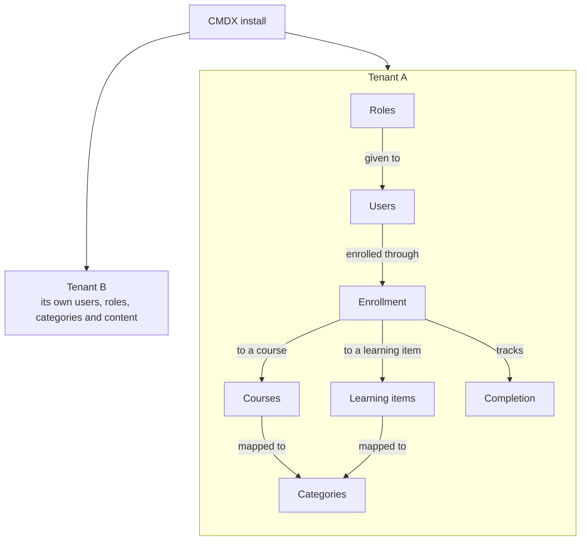
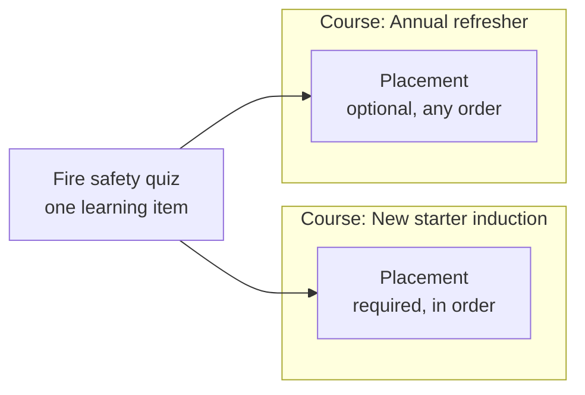

One CMDX install hosts many **tenants**. Inside each tenant:

- **users** are given **roles**;
- **categories** sort **courses** and **learning items**;
- **enrollments** connect users to courses or learning items, and track their **completion**.

One idea sets CMDX apart: content isn't copied into courses. You create a learning item once, then place it in every course that needs it.

## Everything lives in a tenant

A tenant is the space for one company, school or team. Each tenant's users and content are kept apart from every other tenant's.

- **Users and roles.** Users join a tenant as members. Each member has a role, such as learner, instructor or administrator, and the role decides what they can do. Members can be grouped into departments. A person can belong to more than one tenant, with a different role in each.
- **Categories.** A category works like a folder for courses and learning items, and categories can contain other categories. A category covers the whole tenant, or only the departments you choose. A sub-category takes its parent's departments unless you narrow them.
- **Courses and learning items.** A learning item is one piece of content: a video, quiz, SCORM package, file or assignment. A course arranges learning items into sections, and a section can contain other sections, up to three levels deep. Each course has one main category and can be added to others. A learning item can be in any number of categories.
- **Enrollment and completion.** An enrollment gives a user access to a course, or to a learning item on its own. It records how far the user has got and when they complete it.

## Content is placed, not copied

Say you build a fire safety quiz. New starters must take it in order as part of their induction. In the annual refresher it's optional. You don't make two quizzes. You place the same quiz in both courses, with different settings:

A **placement** puts one learning item into one course or section. The item keeps the content. The placement keeps the settings that belong to that course:

- where the item appears in the course;
- whether learners must complete it;
- whether learners must take it in order, or can take it at any time. If the placement doesn't say, it follows the section, then the course;
- how much it counts toward the course grade;
- optionally, its own completion rule, such as a higher pass mark for this course.

An item can be placed in many courses, but only once in the same course or section.

## Categories and placements do different jobs

Both link a learning item to something else, so they're easy to mix up. A category says what the item is about. A placement says where learners take it.

| | Category | Placement |
| --- | --- | --- |
| Links | a course or learning item to a category | a learning item to a course or section |
| Used for | finding, grouping and managing content | taking the item as part of a course |
| How many | any number per item; a course has one main category | one per course or section |
| Changes for learners | how content is grouped when they browse | order, whether it's required, grading and completion |

Items placed in a course are listed under that course's category too, so you don't have to add them to it one by one. Roles given on a category normally apply to every course in it, including courses added to it as an extra category.

## Learning items outside a course

A learning item doesn't have to be in a course. A **standalone** item has no placement, and learners enroll in the item itself. If you later place it in a course, the progress learners already made carries over.

## Progress is kept per course

CMDX tracks each learner's progress separately for every placement. A new starter who passes the fire safety quiz in the induction course hasn't completed it in the refresher yet.

There's one exception. For videos and other media, CMDX also records how much of the item each learner has watched. That record is called **mastery**. It belongs to the item, so it counts in every course the item is in.

## What this means in practice

- **Edit once, change everywhere.** A change to a learning item shows in every course that uses it. To change it for one course only, create a separate item.
- **Check the placement first.** When an item behaves differently in two courses, the difference is in the placement settings.
- **A course's category affects who manages it.** Roles given on a category apply to the courses in it, so moving a course to another category changes which roles apply.
- **Removing isn't deleting.** Removing an item from a course deletes the placement only. The item and its other placements stay.

For short definitions of these terms, see the [glossary](./glossary.md).
