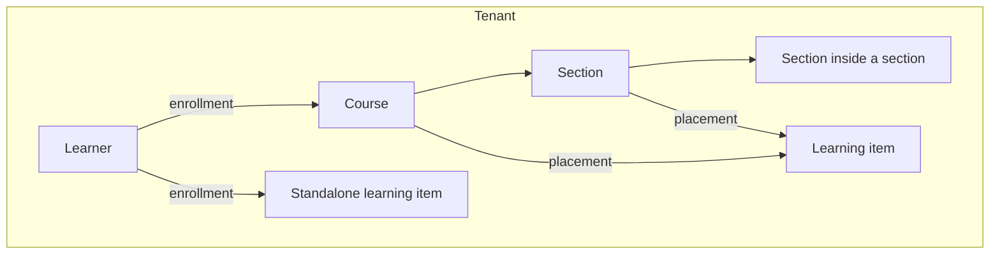

CMDX keeps learning content separate from the courses that use it. You create a learning item once, then place it in as many courses as you need. This page explains how tenants, courses, sections, learning items, placements and enrollments fit together. For short definitions, see the [glossary](./glossary.md).

## Context

In many learning systems, content lives inside one course. Using it in a second course means copying it, and every copy then has to be updated separately.

CMDX treats a learning item as content in its own right. A course doesn't own its items. It points to them, and it decides how each one is used there.

## The design

### Tenant

A tenant is one customer's own space in CMDX. Its members, courses, learning items, enrollments and settings are kept apart from every other tenant. Each member has a role in the tenant, such as learner or instructor. A person can be a member of more than one tenant, with a different role in each.

### Course and section

A course is what learners enroll in. Inside a course, sections group the content, and a section can contain further sections.

### Learning item

A learning item is a single piece of learning content, such as a SCORM package, a video, a file, a quiz or an assignment. Each item is drafted, then published, and can later be archived.

### Placement

A placement puts a learning item into a course or a section. The same item can have placements in many courses, but only one in any one course or section.

The placement holds the settings that belong to that course rather than to the item:

- where the item appears in the order;
- whether learners must complete it;
- whether learners can take items in any order or must follow the sequence. Unless the placement sets this, it follows the section, then the course.

### Standalone learning item

A learning item doesn't have to be in a course. A standalone item has no placement, and learners are enrolled in the item itself. If you later place a standalone item in a course, the progress learners already made on it carries over into that course.

### Enrollment

An enrollment records that a learner belongs to a course, or to a standalone learning item. It's what gives the learner access.

### Completion and progress

Each learning item has completion rules, such as viewing it, scoring at least a set mark, or watching most of a video. A placement can change those rules for one course. CMDX tracks each learner's progress separately for every placement, so the same quiz can be complete in one course and not yet started in another.

### Mastery

For video and other media, CMDX also records how much of the item each learner has watched. That record, called mastery, belongs to the learning item, not to a course, so it carries across every course the item appears in.

## Trade-offs

- **One edit, everywhere.** Changing a learning item changes it in every course that places it. That keeps content consistent, but an edit can't be limited to one course; for a course-specific variant, create a separate item.
- **Settings live in two places.** The item holds what the content is; the placement holds how one course uses it. When something behaves differently in two courses, check the placement settings first.
- **Removing is not deleting.** Removing an item from a course deletes the placement only. The learning item, and its placements in other courses, stay.
