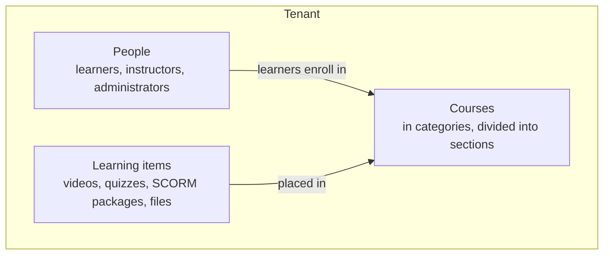
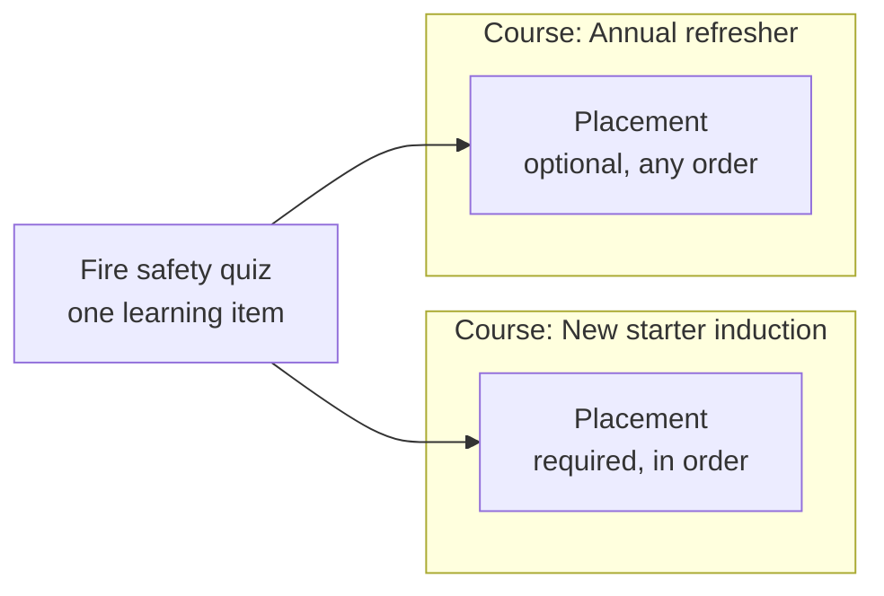

CMDX is built on four ideas:

- a **tenant** holds everything;
- **courses** give learning a structure;
- **learning items** hold the content;
- **enrollments** give learners access.

One idea sets CMDX apart: content isn't copied into courses. You create a learning item once, then place it in every course that needs it.

## Everything lives in a tenant

A tenant is your own space in CMDX, set up for one company, school or team. Everything in the picture belongs to one tenant, and nothing is shared between tenants.

- **People.** People join a tenant as members, and each member has a role there, such as learner, instructor or administrator. A person can belong to more than one tenant, with a different role in each.
- **Courses.** Categories group courses, and sections divide a course into parts. A section can contain other sections, up to three levels deep.
- **Learning items.** Videos, quizzes, SCORM packages, files and assignments. They belong to the tenant, not to a course.

## Content is placed, not copied

Say you build a fire safety quiz. New starters must take it in order as part of their induction. In the annual refresher it's optional. You don't make two quizzes. You place the same quiz in both courses, with different settings:

A **placement** puts one learning item into one course or section. The item keeps the content. The placement keeps the settings that belong to that course:

- where the item appears in the course;
- whether learners must complete it;
- whether learners must take it in order, or can take it at any time. If the placement doesn't say, it follows the section, then the course;
- how much it counts toward the course grade;
- optionally, its own completion rule, such as a higher pass mark for this course.

An item can be placed in many courses, but only once in the same course or section.

## Enrollment gives access

Learners enroll in a course, and that gives them access to the items placed in it.

A learning item doesn't have to be in a course. A **standalone** item has no placement, and learners enroll in the item itself. If you later place it in a course, the progress learners already made carries over.

## Progress is kept per course

CMDX tracks each learner's progress separately for every placement. A new starter who passes the fire safety quiz in the induction course hasn't completed it in the refresher yet.

There's one exception. For videos and other media, CMDX also records how much of the item each learner has watched. That record is called **mastery**. It belongs to the item, so it counts in every course the item is in.

## What this means in practice

- **Edit once, change everywhere.** A change to a learning item shows in every course that uses it. To change it for one course only, create a separate item.
- **Check the placement first.** When an item behaves differently in two courses, the difference is in the placement settings.
- **Removing isn't deleting.** Removing an item from a course deletes the placement only. The item and its other placements stay.

For short definitions of these terms, see the [glossary](./glossary.md).
