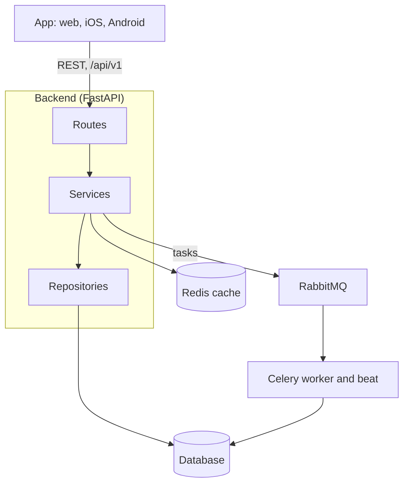

This guide is for platform engineers, plugin authors and API integrators. This page explains how CMDX is put together, so that the rest of the guide has a map to hang on.

CMDX is a multi-tenant learning management system. A Python backend serves a REST API, and one TypeScript app uses that API on the web, iOS and Android.

## The parts

A request from the app reaches the backend's routes, then its services and repositories, and ends in the database. Work that should not hold up a request goes through RabbitMQ to the Celery workers.

Each part, and what it is built with:

| Part | Built with | What it does |
| --- | --- | --- |
| Backend | Python 3.12, FastAPI, async SQLAlchemy, Pydantic v2 | Serves the REST API under `/api/v1`, enforces permissions and tenant isolation, and owns the schema. |
| Database | PostgreSQL by default; MySQL or MariaDB, SQL Server and Oracle are also offered; SQLite for evaluation only | Stores every tenant's data in one schema. |
| Cache | Redis | Caches data for the API. |
| Background work | Celery workers and a Celery beat scheduler, with RabbitMQ as the broker | Runs queued and scheduled jobs, such as notification delivery, audit export and enrollment expiry. |
| Tracing | OpenTelemetry, exported to Jaeger in the Docker setup | Records request traces. |
| App | Expo, React Native and React, in TypeScript | One codebase for the web app and the iOS and Android apps. |

To run all of these on your machine, follow [Install CMDX and create a course](/getting-started/quick-start).

## Backend

The backend code sits in four top-level folders.

- **`core/`** is the framework every feature builds on: authentication, the database layer, tenancy, caching, hooks, events, the plugin loader, background tasks, storage, logging, translations and security helpers.
- **`modules/`** holds the features: users, courses, enrollments, grades, notifications, reports and the rest. Each learning item type, such as quiz, SCORM, file or media, is its own module.
- **`plugins/`** holds plugins that ship with CMDX, such as announcements and gamification. A plugin is loaded at start-up and is switched on or off per tenant, without changing the code in `core/` or `modules/`.
- **`api/`** mounts every module's routes under `/api/v1`.

### Inside a module

A module keeps its layers in separate folders, and a request passes through them in order:

1. **Routes** (`api/`) check the caller's identity and permissions and validate the request against the module's **schemas** (`schemas/`).
2. **Services** (`services/`) hold the business rules.
3. **Repositories** (`repositories/`) read and write the **models** (`models/`), and apply the tenant scope to their queries.

Keeping data access in repositories keeps tenant filtering out of the business rules. [Architecture layers](./architecture/layers.md) explains the rules for each layer.

A module also brings its own migrations, permissions and install step.

### Learning item types

Courses contain learning items. Each learning item type registers a provider with the learning items module when the backend starts. The learning items module handles what all types share, such as placement in a course, completion and progress, and calls the provider for the type-specific work. Adding a built-in type means adding a module with its provider and adding the type to the list of built-in types. See [The learning item contract](./plugins/learning-item-contract.md).

### Tenants

All tenants share one database and one schema. Tenant-owned rows record their tenant, and repositories filter on it. A schema or database per tenant is not supported. [Multi-tenancy](./architecture/multi-tenancy.md) covers how the tenant is resolved for each request.

### Extending CMDX

Plugins extend CMDX without changing its code. A plugin declares itself in a manifest and is discovered when the backend starts. An administrator installs it once, then enables it for each tenant that needs it. Plugins react to what happens in CMDX through hooks and events.

- [Plugin system](./architecture/plugin-system.md)
- [Hooks and events](./architecture/hooks-and-events.md)
- [Build a plugin](./plugins/build-a-plugin.md)

## App

The app is built with Expo, React Native and React, and the web version is a static export. Its code follows the same split as the backend:

- **`core/`**: the API client, authentication, storage and theming.
- **`components/`**: shared UI, from basic elements up to page templates.
- **`modules/`**: the screens, grouped by who uses them: administrators, instructors and learners.
- **`plugins/`**: app-side plugins.

Routes are files: each file under `app/` maps a URL to a screen in `modules/`.

## API

The app uses the same REST API that integrations call. Outside production, the backend serves its OpenAPI description at `/openapi.json`, with interactive documentation at `/docs`.

- [Authentication](./api/authentication.md)
- [Pagination and filtering](./api/pagination-and-filtering.md)
- [Errors](./api/errors.md)

## Where to go next

- New to the codebase: read [Architecture layers](./architecture/layers.md), then [Multi-tenancy](./architecture/multi-tenancy.md).
- Writing a plugin or a learning item type: start with [Build a plugin](./plugins/build-a-plugin.md).
- Contributing to CMDX: set up your environment with [Development setup](./contributing/setup.md).
